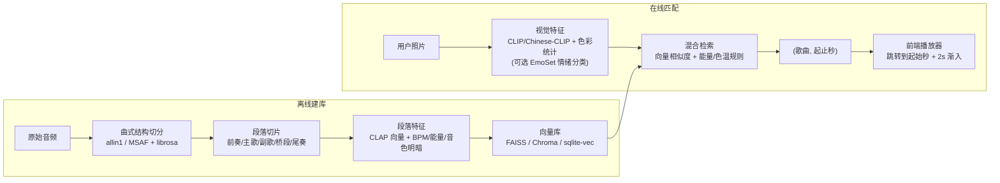

# AGENTS.md — 身临其境（Immersion）

> 本文件面向参与本项目开发的 AI 编码助手与协作者。动手修改代码前请先通读，尤其是「硬性约束」和「设计语言」两节。

---

## 1. 项目一句话

**上传一张照片 → 识别照片的情绪与意境 → 从曲库中匹配一首歌，并精确定位到这首歌最契合的那一个段落（如副歌 01:16–02:12）开始播放。**

- 只做**匹配**，不做 AI 生成音乐。
- 当前阶段只做**照片版**（后续可能扩展到视频/实时取景，暂不考虑）。

---

## 2. 参赛背景

项目用于参加 **B站「Build in Bilibili（BIB）· AI 创造公开赛」第二赛季**。

| 项目 | 内容 |
| :--- | :--- |
| 赛季启动 | 2026-10-24 |
| 截止时间 | 官方暂未公布，会提前 ≥30 天在 `@哔哩哔哩弹幕网` 公告（以官方为准） |
| 参赛形式 | **个人参赛**（一人包揽开发、曲库整理、视频制作与运营），使用本人账号投稿，无需联合投稿 |
| 作品要求 | 用 AI 做出**可运行、可交互的产品**（纯 AIGC 视频/图片不算）；横屏视频 ≥1 分钟，带 `#B站AI创造公开赛` 标签，同一产品的视频放入同一**合集** |
| 赛制核心 | Build in Public：持续连载开发过程，观众即用户；AI 初筛 + 用户评审团投票 |
| 可关注的单元赛道 | NVIDIA RTX Spark 本地 AI 单元（与我们"本地小模型"路线契合）、Google 出海创新单元 |

> 以上规则信息来自网络检索，**提交前务必以 B站官方活动页为准**。

**对开发的影响**：
- 每个里程碑都应该能产出一个"可演示、可录屏"的版本，方便连载视频。
- 一人开发，精力有限：优先选**成熟、开箱即用**的开源工具，避免自研训练；每个阶段控制在 1–2 周内可完成的范围；开发与做视频的时间要一起规划。

---

## 3. 硬性约束（不要违反）

1. **不使用通用闭源大模型**（GPT / Gemini / Claude / 豆包等 API）做核心识别。视觉理解使用开源小模型或可本地运行的模型。
2. **不使用 AI 生成音乐**（Suno / Udio / MusicGen 等）。音乐全部来自曲库，只做检索与匹配。
3. **匹配粒度必须到段落级**：结果 = `(歌曲, 段落起始秒, 段落结束秒)`，而不是只给一首歌。
4. **诚实标注占位内容**：凡是演示用的假数据、合成音、程序生成的图片，必须在 UI 或代码注释中明确标注为"演示/占位"。不要在界面上展示伪造的模型名称、延迟数字或相似度分数。
5. **版权**：公开演示版本只使用有授权的音乐（无版权曲库、CC 授权、自有作品，或仅存储特征向量 + 外链播放）。不要把受版权保护的完整音频提交进仓库。

---

## 4. 技术方案（规划）

整体分为**离线建库**和**在线匹配**两部分。



### 4.1 视觉侧（候选）
| 方案 | 用途 | 备注 |
| :--- | :--- | :--- |
| 色彩统计（主色、色温、明度、饱和度） | 基础特征、驱动 UI 背景色 | 已在原型中实现（浏览器端） |
| Chinese-CLIP / CLIP / SigLIP | 与"意境词库"做零样本相似度 | 需要自建意境词表（如"黄昏""雨夜""辽阔"） |
| EmoSet 等图像情绪模型 | 情绪分类 / Valence-Arousal | 需确认可用权重与许可证 |
| Qwen2.5-VL-3B / MiniCPM-V 等开源小 VLM | 更细的场景描述（可选） | 体积较大，按需引入 |

### 4.2 音乐侧（候选）
| 工具 | 用途 |
| :--- | :--- |
| `allin1` / `MSAF` | 识别曲式结构，输出段落起止时间 |
| `librosa` | BPM、RMS 能量、频谱质心等声学特征 |
| `LAION-CLAP` | 音频片段 → 与文本/意境词同空间的向量 |
| `FAISS` / `Chroma` / `sqlite-vec` | 存储和检索段落向量 |

### 4.3 关键技术风险（尚未验证）
- 图像向量与音频向量**不在同一空间**：需要以文本（意境词）为桥，或训练一个小的映射层。这是项目最核心、最需要实验的部分。
- 曲式切分对非流行曲（纯音乐、氛围音乐）的准确率未知。
- "匹配得准不准"缺少客观指标，需要设计人工评测方式（例如小规模盲测）。

---

## 5. 当前进度

| 模块 | 状态 |
| :--- | :--- |
| 前端界面原型 | ✅ 已完成（苹果风、拍立得、流体背景） |
| 浏览器端色彩分析 | ✅ 已实现（真实计算） |
| 曲库 | ✅ 已接入 `demo list/` 下的 **33 首真实 MP3 曲目**，生成段落级索引 `data/demo_library.json` |
| 音频播放 | ✅ 已接入真实 MP3 播放，支持跳转到命中段落起始秒 + 2s 渐入 + 段落循环/整首连播 |
| 本地模型权重 | ✅ 已下载至 `model/`（`allin1`、`Chinese-CLIP`、`EmoSet-ViT`、`LAION-CLAP`） |
| 音乐切段流水线 | ✅ 已实现基于 FFmpeg PCM + 对数响度/频谱新颖度的离线切段脚本 `pipeline/analyze_demo_list.mjs` |
| 后端服务（模型在线推理） | ✅ 已接入本地 Chinese-CLIP + CLAP 意境描述桥接，FastAPI 提供匹配；CPU 实跑通过，服务失败明确降级色彩规则 |
| 新旧匹配对照 | ✅ `picture/` 183 张全量完成；首选覆盖 22→22，前三覆盖 27→29；结果见 `outputs/semantic-comparison/`，听感尚待盲测 |

本轮语义实现位于 `server/`；离线建库为 `pipeline/build_semantic_index.py`，对照为 `pipeline/evaluate_semantic.py`。现有 `model/emoset-vit/` 实际是人脸表情模型，不用于风景意境。音乐边界仍使用旧声学规则，未接入 allin1。运行方式见 README。

---

## 6. 目录结构

```
身临其境/
├── AGENTS.md      # 本文件
├── index.html     # 前端主页面（已内联 33 首真实曲目段落索引，可直接双击打开并播放 demo list 音频）
├── demo list/     # 33 首测试用真实 MP3 音频文件
├── model/         # 本地开源小模型权重库（allin1, chinese-clip, emoset-vit, clap-htsat-unfused）
├── pipeline/      # 离线建库与测试脚本（analyze_demo_list.mjs, build_index_html.mjs, test_matching.mjs）
└── data/          # 生成的段落级曲库特征索引（demo_library.json）
```

规划中的结构（引入后端后）：

```
身临其境/
├── web/           # 前端
├── server/        # 匹配服务（Python，FastAPI）
├── pipeline/      # 离线建库脚本：切段、提特征、入库
├── data/          # 本地数据（向量库、元数据；不提交音频原文件）
└── docs/          # 实验记录、连载视频素材笔记
```

---

## 7. 设计语言（前端必须遵守）

用户明确要求：**苹果风、简约、高级、线条感、拍立得、流体背景**。避免"赛博科技仪表盘"风格。

- **配色**：浅色为主，底色 `#f5f5f7`，主文字 `#1d1d1f`，次要文字 `#6e6e73`，分隔线 `rgba(0,0,0,0.08)`。
- **字体**：系统字体栈（`-apple-system, "SF Pro Display", "PingFang SC" …`）；拍立得手写区用楷体。
- **线条**：1px 细线分隔，圆角克制；不使用霓虹描边、发光、网格、HUD 准星。
- **信息密度**：低。一个屏幕只讲一件事——照片和它的那段音乐。不堆技术参数面板。
- **动效**：慢、柔、有物理感（缓动 `cubic-bezier(0.22, 1, 0.36, 1)`）。拍立得"显影"、背景随主色调渐变流动、播放时背景轻微"呼吸"。
- **流体背景实现**：低分辨率 canvas（160×100）绘制多个径向渐变色块，CSS 放大 + 轻度 blur，性能友好。颜色取自照片主色并向白色提亮。
- **文案**：短、克制、有画面感（如"风把落日，吹成了慢镜头"），避免营销腔。

---

## 8. 开发约定

- **语言**：界面文案与文档使用简体中文；代码标识符使用英文。
- **前端**：原型阶段保持零依赖、单文件可打开；引入框架前先与用户确认。
- **后端（规划）**：Python 3.10+，FastAPI；模型推理优先本地运行。
- **改动范围**：只改与当前任务相关的部分，保留无关的注释与文档。
- **占位数据**：集中放置并加注释 `// 演示占位`，方便后续整体替换。
- **验证**：修改 JS 后至少做一次语法检查（如 `node --check`）；涉及界面的改动应说明如何手动验证。

---

## 9. 路线图（建议）

| 阶段 | 目标 | 可连载的视频内容 |
| :--- | :--- | :--- |
| M0 | 界面原型 ✅ | 第 1 期：立项 + 想法 + 界面首秀 |
| M1 | 用 50–100 首授权音乐跑通切段 + 特征提取 | 第 2 期：把一首歌"拆开"给你看 |
| M2 | 接入 CLIP 类视觉模型 + 意境词桥接，完成第一版匹配 | 第 3 期：第一次真正"听见照片" |
| M3 | 前端接真实音频，实现按秒跳转 + 渐入 | 第 4 期：观众投稿照片现场测试 |
| M4 | 根据弹幕/评论迭代（如整活模式、候选歌单、分享卡片） | 第 5 期起：观众共建 |

---

## 10. 待确认问题

- 曲库来源与授权方式。
- 目标运行环境：纯本地（可冲 NVIDIA 单元）还是部署在线供观众试玩，或两者都要。
- 拍立得比例（正方形 / Instax Mini 竖版）、是否需要深色模式。
